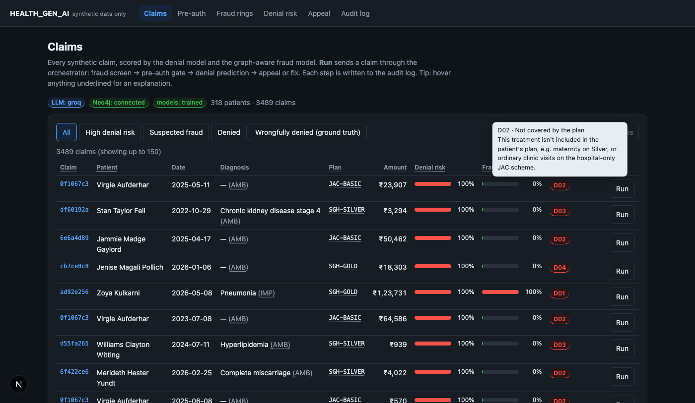
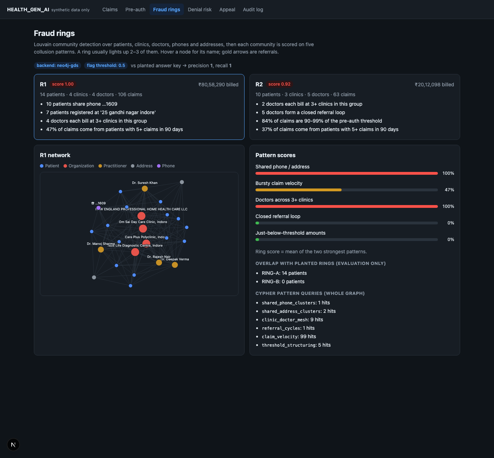
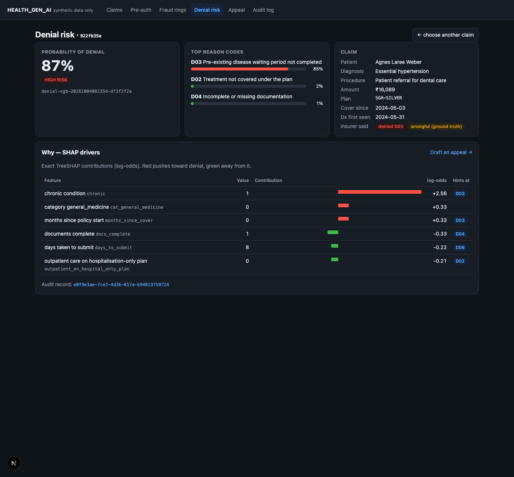

# Health GenAI: Insurance Claims Intelligence Platform

A GenAI platform for the Indian health-insurance claims space. For every claim it drafts the **pre-authorisation**, detects **fraud rings** in a graph, predicts **denials** with reasons, writes **cited appeal letters** for wrongly denied claims, and records every decision in a **tamper-evident audit log**.

> Synthetic data only (Synthea FHIR patients + planted fraud rings). The insurer, plans and policy wordings are fictional.



## What it does

| | Capability | How |
|---|---|---|
| 1 | **Pre-auth drafting** | LangGraph agent reads a patient's FHIR R4 record, checks the plan's rules, retrieves policy clauses (RAG) and drafts the request as a FHIR `Claim` (`use = preauthorization`) |
| 2 | **Fraud-ring detection** | Neo4j graph of patients, doctors, clinics, phones and addresses; Cypher pattern queries + weighted Louvain (GDS) find colluding rings. **Both planted rings found, zero false positives** |
| 3 | **Denial prediction** | XGBoost risk + reason-code models (**ROC-AUC 0.96**) with TreeSHAP drivers mapped to insurer denial codes |
| 4 | **Auto-appeal** | Agentic RAG: plans queries → grades evidence → re-queries → drafts → verifies every citation in code → revises. A cited letter in ~10 s |
| 5 | **Trust / audit** | Every decision stored with inputs, model version, LLM, retrieval context; SHA-256 hash chain detects tampering |

A LangGraph **orchestrator** routes each claim: fraud screen → pre-auth gate → denial prediction → *submit / fix / appeal / refer to investigation*. Fraud always comes first, so the system never argues for paying a suspicious claim.

<p>
  
  
</p>

## Tech stack
**Agents & LLM:** LangGraph · Groq (GPT-OSS 120B) / OpenAI / Ollama behind one interface · **RAG:** ChromaDB + FastEmbed · **Graph:** Neo4j 5.26 + Graph Data Science, Cypher · **ML:** XGBoost, scikit-learn, TreeSHAP · **Data:** Synthea, FHIR R4, pandas · **API/UI:** FastAPI, Next.js 15 · **Trust:** SQLite hash-chained audit log

## Design highlights
- **Facts in code, prose from the LLM.** Amounts, dates, coverage and appeal viability come from a deterministic rule engine. The LLM only writes text, and must cite retrieved chunks that code then verifies.
- **The model learns the insurer's bug.** The simulated insurer wrongly applies the pre-existing-disease waiting period to conditions diagnosed *after* the policy began. The denial model learns it (visible in SHAP), and the appeal agent beats it with the policy's own definition.
- **Weighted community detection.** Without interaction weights, one camouflage hospital visit pulled a whole ring into a legitimate community.

## Run it
See **[MASTER_README.md](MASTER_README.md)** for architecture, setup and run order (including a no-Docker route), and **[LEARNING_GUIDE.md](LEARNING_GUIDE.md)** for a file-by-file reading order. Quick offline demo with no API keys, Java or Docker:

```bash
python3.12 -m venv .venv && source .venv/bin/activate && pip install -r requirements.txt
cp .env.example .env && echo "LLM_PROVIDER=mock" >> .env
make all-offline                 # generate data → plant rings → train → index
make api                         # terminal 1
cd ui && npm install && npm run dev   # terminal 2 → http://localhost:3000
```
